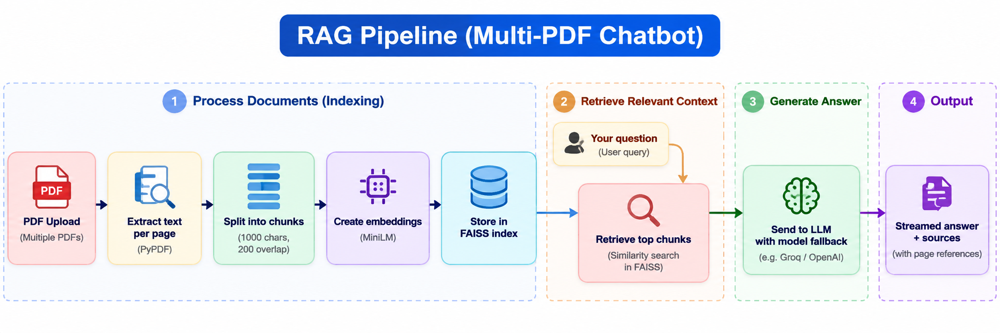

# PageWise: Chat with Your PDFs

Ask questions about one or more PDFs and get answers with **page-level source citations**. Built with Streamlit, local embeddings, and Groq-hosted LLMs, with automatic fallback when a model hits its rate limit.

**Live demo:** _add your Streamlit link here_


<!-- Replace with a real screenshot or GIF of the app in action. -->

## Features

- **Multi-PDF chat:** upload several PDFs and ask questions across all of them.
- **Source citations:** every answer lists the file and page numbers it came from.
- **Local embeddings:** PDF text is embedded on your machine with `all-MiniLM-L6-v2`, so processing is free and needs no API key.
- **Automatic model fallback:** if a Groq model is rate limited, the app skips it and tries the next one, and remembers which models to skip for a while.
- **"Cover every document" mode:** summary and comparison questions sample text from every file, so no PDF gets left out.
- **Streaming answers** with a note showing which model answered.
- **One LLM call per question:** follow-ups are handled locally, which saves API quota.
- **Built-in guidance:** an in-app "How to ask good questions" guide and a disclaimer and privacy notice.
- **Bring your own key:** users can paste their own Groq API key in the sidebar.

## How it works



1. Text is extracted page by page, keeping the file name and page number as metadata.
2. Pages are split into overlapping chunks and embedded locally into a FAISS vector index.
3. For each question, the most relevant chunks are retrieved (or, for summaries, chunks spread across every document).
4. Only those chunks plus the last few chat messages are sent to a Groq model to write the answer.

## Tech stack

| Part | Tool |
|---|---|
| UI | Streamlit |
| PDF parsing | pypdf |
| Chunking | LangChain text splitters |
| Embeddings | sentence-transformers `all-MiniLM-L6-v2` (local) |
| Vector store | FAISS |
| LLM | Groq via `langchain-groq` |

## Getting started

### 1. Clone and install

```bash
git clone <your-repo-url>
cd <your-repo-folder>

python -m venv .venv
# Windows:   .venv\Scripts\activate
# macOS/Linux: source .venv/bin/activate

pip install -r requirements.txt
```

### 2. Add your API key

Get a free key at [console.groq.com/keys](https://console.groq.com/keys), then copy the example file and edit it:

```bash
cp .env.example .env      # Windows: copy .env.example .env
```

```
GROQ_API_KEY=your-groq-key-here
```

### 3. Run

```bash
streamlit run app.py
```

Upload your PDFs in the sidebar, click **Process**, and start asking questions. The first run downloads the embedding model, so it takes a little longer.

## Configuration

| Setting | Where | Description |
|---|---|---|
| `GROQ_API_KEY` | `.env` | Your Groq API key |
| `GROQ_MODELS` | `.env` (optional) | Comma-separated models to try in order |
| Models box | Sidebar | Same as above, one per line, changeable while the app runs |
| API key box | Sidebar | Overrides the key from `.env` for this session only |

Groq's available models and limits change over time, so check the [Groq model list](https://console.groq.com/docs/models) and your own usage limits. A model name that no longer exists is simply skipped.

## Tips for good questions

- **Specific:** "What projects are listed in resume.pdf?"
- **Summaries:** "Summarize each document" covers every uploaded file.
- **Comparisons:** "Compare the experience described in these documents."
- **Follow-ups:** "Tell me more about the second project."

The app answers only from your PDFs. If something isn't in them, it will say so.

## Deployment

The app is deployable on [Streamlit Community Cloud](https://streamlit.io/cloud):

1. Push the repo to GitHub (make sure `.env` is in `.gitignore`).
2. Create a new app on Streamlit Community Cloud pointing at `app.py`.
3. Add `GROQ_API_KEY` in the app's **Secrets** settings.

Note: `sentence-transformers` installs PyTorch, which is memory-heavy. If the free tier runs out of memory, try a host with more RAM, such as Hugging Face Spaces.

## Limitations

- Only selectable text is read. Scanned or image-only PDFs need OCR, which isn't included.
- Charts, images, and complex tables may not be read correctly.
- Only a few passages are used per question, so questions that need the whole document (exact counts, "list every number") work poorly.
- Summaries of very long documents are approximate, because only a limited number of excerpts fit in the prompt.
- Answers are AI-generated and can be wrong. Check the cited pages.

## Privacy

PDFs are processed in the running session and are not saved by this app. To answer a question, the relevant text excerpts and recent chat messages are sent to Groq's API, which is subject to Groq's privacy policy. Don't upload confidential or sensitive documents.

## Project structure

```
.
├── app.py             # Streamlit app: PDF processing, retrieval, LLM fallback, UI
├── requirements.txt
├── .env.example       # Template for your API key
└── .gitignore
```

## Possible improvements

- OCR support for scanned PDFs
- Clickable example questions
- Hybrid (keyword + vector) search and reranking
- Persistent vector storage across sessions
- Automated tests for the fallback logic

## License

MIT. Add a `LICENSE` file if you choose this license.